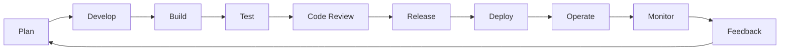

# DevOps Workflow & SDLC Lab

A hands-on learning project exploring DevOps practices, Software Development Life Cycle (SDLC), Agile methodology, Git collaboration, CI/CD fundamentals, deployment strategies, and monitoring workflows.

## Project Overview

This project demonstrates how a software development team can organize its workflow using DevOps principles and modern software engineering practices.

It covers the journey from planning and development to version control, testing, code review, deployment, monitoring, and continuous feedback.

The project focuses on understanding how different stages of software development work together to deliver reliable and maintainable software.

## Project Objectives

- Understand the fundamentals and culture of DevOps.
- Explore the complete Software Development Life Cycle (SDLC).
- Learn Agile and Scrum methodologies.
- Understand Git version control and branching strategies.
- Practice GitHub collaboration using Issues and Pull Requests.
- Understand code review and team collaboration workflows.
- Design a conceptual CI/CD pipeline.
- Explore deployment strategies and monitoring practices.
- Build professional technical documentation.

## Learning Outcomes

After completing this project, I aim to be able to:

- Explain the DevOps lifecycle and its stages.
- Differentiate between traditional SDLC and DevOps.
- Understand Agile, Scrum, Sprints, and Backlogs.
- Work with Git branches and meaningful commits.
- Understand GitHub Issues, Pull Requests, and code reviews.
- Explain how CI/CD pipelines automate software delivery.
- Compare common deployment strategies.
- Understand monitoring, feedback, and continuous improvement.
- Document software engineering workflows professionally.

## Topics Covered

| No. | Topic | Status |
|---|---|---|
| 01 | DevOps Fundamentals | Planned |
| 02 | DevOps Lifecycle | Planned |
| 03 | Software Development Life Cycle (SDLC) | Planned |
| 04 | Agile Methodology & Scrum | Planned |
| 05 | DevOps Culture | Planned |
| 06 | Development Environments | Planned |
| 07 | Git Version Control | Planned |
| 08 | GitHub Collaboration | Planned |
| 09 | Git Branching Strategy | Planned |
| 10 | Code Review | Planned |
| 11 | CI/CD Fundamentals | Planned |
| 12 | Deployment Strategies | Planned |
| 13 | Monitoring & Feedback | Planned |

## Tools & Technologies

The following tools will be used throughout this project:

| Category | Tools |
|---|---|
| Version Control | Git |
| Collaboration | GitHub |
| Project Management | GitHub Issues, GitHub Projects |
| Code Review | GitHub Pull Requests |
| CI/CD Demonstration | GitHub Actions |
| Documentation | Markdown |
| Workflow Diagrams | Mermaid, Draw.io |
| Code Editor | Visual Studio Code |
| Development Environment | Ubuntu, WSL |

## DevOps Workflow

The following diagram represents the high-level workflow explored in this project.



This workflow represents the continuous collaboration and improvement cycle used in DevOps environments.

## Repository Structure

```text
Devops-Workflow-And-SDLC-Lab/
│
├── README.md
├── LICENSE
│
├── docs/
│   ├── 01-devops-fundamentals.md
│   ├── 02-devops-lifecycle.md
│   ├── 03-sdlc.md
│   ├── 04-agile-scrum.md
│   ├── 05-devops-culture.md
│   ├── 06-environments.md
│   ├── 07-version-control.md
│   ├── 08-github-collaboration.md
│   ├── 09-branching-strategy.md
│   ├── 10-code-review.md
│   ├── 11-cicd-fundamentals.md
│   ├── 12-deployment-strategies.md
│   └── 13-monitoring-feedback.md
│
├── diagrams/
│   ├── devops-lifecycle.png
│   ├── sdlc-workflow.png
│   ├── git-branching.png
│   └── cicd-pipeline.png
│
├── .github/
│   ├── ISSUE_TEMPLATE/
│   ├── PULL_REQUEST_TEMPLATE.md
│   └── workflows/
│
├── screenshots/
│
└── LICENSE
```

*Note: The structure above represents the planned repository organization. Files and directories will be added as the project progresses.*

## Implementation Roadmap

The project will be completed through eight stages:

| Stage | Description |
|---|---|
| 01 | DevOps & SDLC Fundamentals |
| 02 | DevOps Lifecycle |
| 03 | Agile & Scrum |
| 04 | Git Workflow |
| 05 | GitHub Collaboration |
| 06 | CI/CD Workflow Design |
| 07 | Deployment & Monitoring |
| 08 | Final Documentation & Assessment |

## Project Progress

**Current Status:** In Progress

- [x] GitHub repository created.
- [x] MIT License added.
- [x] Professional README documentation.
- [ ] DevOps and SDLC documentation.
- [ ] Workflow diagrams.
- [ ] Git branching and collaboration demonstration.
- [ ] Basic CI/CD workflow demonstration.
- [ ] Deployment and monitoring documentation.
- [ ] Final assessment and project report.

## Project Scope

This project focuses on DevOps fundamentals, collaboration, workflow design, and documentation.

Advanced hands-on implementation of Docker, AWS infrastructure, Kubernetes, and production CI/CD pipelines will be covered in separate portfolio projects.

## Author

**MD Arifuzzaman Hredoy**

Aspiring Junior DevOps Engineer

GitHub: `arifuzzaman-hredoy`

---

*This project is part of my continuous DevOps learning and professional portfolio journey.*
