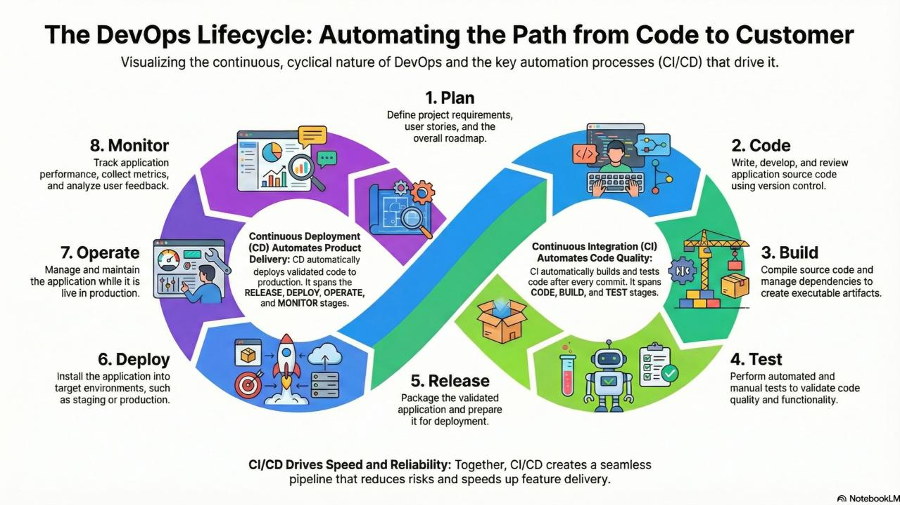

# DevOps Lifecycle

## 1. Introduction

The DevOps Lifecycle is a continuous process that connects software development and IT operations. It enables teams to build, test, release, deploy, operate, and monitor software through collaboration, automation, and continuous feedback.

The lifecycle is not a one-time process. Feedback from production monitoring helps teams plan and improve future releases.

*Figure 1: The continuous DevOps lifecycle and its eight phases.*

## 2. Phases of the DevOps Lifecycle

### 2.1 Plan

The planning phase defines project requirements, features, tasks, priorities, and release goals.

**Typical activities:**
- Gather business and technical requirements.
- Create user stories and tasks.
- Prioritize the development backlog.
- Plan releases and milestones.

**Common tools:** Jira, GitHub Projects, Trello.

### 2.2 Code

Developers write application code and maintain it using version control systems.

**Typical activities:**
- Develop application features.
- Follow coding standards.
- Use Git for version control.
- Push changes to a shared repository.

**Common tools:** Git, GitHub, VS Code.

### 2.3 Build

The build phase transforms source code into a deployable artifact.

**Typical activities:**
- Compile source code when required.
- Install dependencies.
- Build application packages or container images.
- Store build artifacts.

**Common tools:** Maven, Gradle, Docker.

### 2.4 Test

The testing phase verifies that the application works correctly and meets quality requirements.

**Typical activities:**
- Run unit tests.
- Perform integration tests.
- Execute security and quality checks.
- Identify and report defects.

**Common tools:** pytest, JUnit, SonarQube, Trivy.

### 2.5 Release

The release phase prepares a validated version of the application for deployment.

**Typical activities:**
- Version the application.
- Prepare release notes.
- Store approved artifacts.
- Obtain release approval when required.

**Common tools:** GitHub Releases, artifact registries.

### 2.6 Deploy

The deployment phase delivers the application to an environment such as staging or production.

**Typical activities:**
- Deploy the approved application version.
- Apply required configuration.
- Restart or replace application services.
- Verify deployment health.

**Common tools:** Docker, Kubernetes, Ansible, Jenkins.

### 2.7 Operate

The operation phase focuses on maintaining the application and infrastructure in a reliable and secure condition.

**Typical activities:**
- Manage servers and infrastructure.
- Maintain application availability.
- Apply security updates.
- Manage access and configuration.
- Troubleshoot operational issues.

**Common tools:** Linux, AWS, Nginx, Docker.

### 2.8 Monitor

The monitoring phase continuously observes application and infrastructure performance.

**Typical activities:**
- Monitor CPU, RAM, disk, and network usage.
- Track application response times.
- Monitor HTTP errors and service availability.
- Analyze logs and metrics.
- Report incidents and performance problems.

**Common tools:** Prometheus, Grafana, Loki, CloudWatch.

## 3. Continuous Feedback and Improvement

Monitoring results provide feedback to the development and operations teams.

For example, if monitoring detects high CPU usage or frequent HTTP 500 errors, the team investigates the root cause, fixes the issue, tests the solution, and plans an improved release.

This creates a continuous improvement cycle.

## 4. Real-World DevOps Workflow

A typical workflow can look like this:

1. A developer selects a task from the project backlog.
2. The developer writes code and commits changes using Git.
3. The changes are pushed to GitHub.
4. A CI pipeline starts automatically.
5. Automated tests and quality checks run.
6. The application is built into a deployable artifact.
7. The validated artifact is stored in a registry.
8. The CD process deploys the approved version.
9. The production application is checked for health.
10. Monitoring tools collect metrics and logs.
11. The team uses monitoring feedback to improve the next release.

## 5. Deployment and Rollback

A deployment can introduce unexpected problems, such as application crashes or HTTP 500 errors.

A safe production workflow should include:

- Health checks after deployment.
- Application and infrastructure monitoring.
- A rollback plan.
- Access to a previously stable release.
- Verification after rollback.

If a new release causes a critical issue, the team may roll back to the previous stable version while investigating and fixing the problem.

## 6. Responsibilities of a DevOps Engineer

A DevOps Engineer may be responsible for:

- Maintaining CI/CD pipelines.
- Managing infrastructure and deployment environments.
- Automating repetitive operational tasks.
- Monitoring application health and performance.
- Troubleshooting deployment and infrastructure issues.
- Managing logs, metrics, and alerts.
- Supporting rollback and recovery procedures.
- Collaborating with developers and operations teams.

Responsibilities vary depending on the organization and team structure.

## 7. Conclusion

The DevOps Lifecycle creates a continuous workflow between development and operations. By combining collaboration, automation, testing, deployment, monitoring, and feedback, teams can deliver reliable software more efficiently and improve it continuously.
