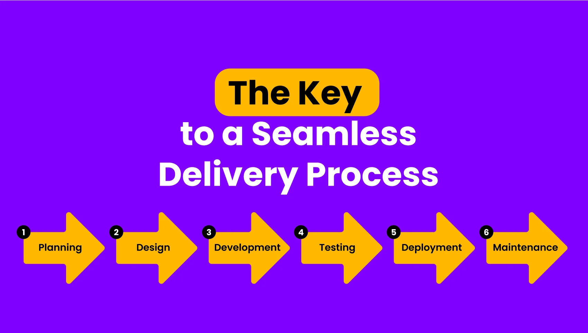

# Software Development Life Cycle (SDLC)

## 1. Introduction

The Software Development Life Cycle (SDLC) is a structured process used by software development teams to plan, design, develop, test, deploy, and maintain software applications.

SDLC provides a systematic approach to software development. It helps teams deliver reliable, secure, maintainable, and high-quality software while managing time, cost, and resources effectively.

For example, when a company develops an e-commerce website, it must identify business requirements, design the application architecture, write code, test the application, deploy it to production, and continuously maintain it.

All these activities are part of the SDLC.

*Figure 1: Overview of the six major phases of the Software Development Life Cycle.*

## 2. Importance of SDLC

SDLC is important because it provides a clear development process and helps organizations manage software projects effectively.

Key benefits include:

- **Structured Development:** Provides a clear sequence of development activities.
- **Better Planning:** Helps estimate project time, cost, and resources.
- **Improved Quality:** Ensures software is tested before production release.
- **Risk Management:** Helps identify technical and operational risks early.
- **Team Collaboration:** Improves communication between developers, testers, project managers, and operations teams.
- **Maintainability:** Makes future updates and bug fixes easier.
- **Customer Satisfaction:** Helps ensure that the final product meets business and user requirements.

## 3. Six Phases of SDLC

A common SDLC approach consists of six major phases.

### 3.1 Planning

Planning is the first phase of SDLC.

During this phase, the organization defines the project's goals, scope, budget, timeline, and required resources.

Key activities:

- Identify the business problem.
- Define project objectives.
- Estimate development costs.
- Identify required technologies.
- Allocate team members and resources.
- Identify potential project risks.

**Example:**

A company decides to build an e-commerce website. The project team estimates the development timeline, budget, team size, and required technologies.

**Output:** Project Plan.

### 3.2 Requirement Analysis

During requirement analysis, the development team collects and analyzes requirements from clients, stakeholders, and end users.

Requirements are generally divided into two categories.

#### Functional Requirements

Functional requirements describe what a software system must do.

Examples:

- User registration and authentication.
- Product search.
- Add products to cart.
- Online payment processing.
- Order tracking.
- User profile management.

#### Non-Functional Requirements

Non-functional requirements describe how well the system should operate.

Examples:

- Performance and response time.
- Security and data protection.
- Availability and reliability.
- Scalability.
- Maintainability.
- Usability.

The requirements are documented so that developers and other team members understand what needs to be built.

**Output:** Software Requirements Specification (SRS).

### 3.3 Design

During the design phase, the development team creates the technical architecture and design of the software.

Key activities:

- Select the technology stack.
- Design application architecture.
- Design the database schema.
- Define API structures.
- Design frontend and backend components.
- Plan security architecture.
- Define infrastructure requirements.

**Example Technology Stack:**

| Component | Technology |
|---|---|
| Frontend | React |
| Backend | Node.js |
| Database | PostgreSQL |
| Web Server | Nginx |
| Cloud Platform | AWS |
| Version Control | Git and GitHub |

The team may also create architecture diagrams, database diagrams, and API documentation.

**Output:** Software Design Document (SDD), Architecture Diagrams, and Database Schema.

### 3.4 Development / Implementation

During the development phase, developers convert the approved design and requirements into working software.

Key activities:

- Write application code.
- Develop frontend components.
- Build backend APIs.
- Implement database operations.
- Integrate application components.
- Write unit tests.
- Commit changes using Git.
- Push code to GitHub.

Development teams commonly use version control systems such as Git to track changes and collaborate.

**Output:** Application Source Code.

### 3.5 Testing

Testing verifies that the software works correctly and meets the specified requirements.

The testing team identifies bugs, errors, security issues, and performance problems before production release.

Common testing types:

| Testing Type | Description |
|---|---|
| Unit Testing | Tests individual functions or components. |
| Integration Testing | Verifies that multiple components work together correctly. |
| System Testing | Tests the complete application as a system. |
| Performance Testing | Evaluates application speed, stability, and behavior under load. |
| Security Testing | Identifies security weaknesses and vulnerabilities. |
| Acceptance Testing | Verifies that the application meets business and user requirements. |

If testing identifies problems, developers fix the issues and the affected tests are executed again.

**Output:** Test Reports and a Verified Application.

### 3.6 Deployment and Maintenance

After the required testing and release approvals are completed, the application is deployed to the production environment.

Deployment makes the software available to its intended users.

Key deployment activities:

- Prepare the production environment.
- Configure application settings.
- Deploy application artifacts.
- Configure database connectivity.
- Verify application health.
- Monitor the deployment.

After deployment, the maintenance phase begins.

Maintenance activities include:

- Bug fixing.
- Security updates.
- Performance optimization.
- Infrastructure maintenance.
- Database backup.
- Feature improvements.
- Application monitoring.
- Disaster recovery planning.

**Output:** Live Production Application and Ongoing Maintenance.

## 4. Common SDLC Models

Different software projects use different SDLC models depending on their requirements, complexity, risks, and development approach.

### 4.1 Waterfall Model

The Waterfall Model follows a sequential development approach.

Each phase is generally completed before the next phase begins.

Typical sequence:

Planning → Requirements → Design → Development → Testing → Deployment → Maintenance

Characteristics:

- Sequential workflow.
- Clearly defined project phases.
- Extensive documentation.
- Changes can be difficult and expensive later in development.

Best suited for projects with stable and clearly defined requirements.

### 4.2 Agile Model

Agile is an iterative and incremental approach to software development.

Instead of developing the entire application in one long cycle, teams deliver software through smaller iterations.

Characteristics:

- Frequent software releases.
- Continuous customer feedback.
- Flexible requirement changes.
- Strong team collaboration.
- Regular testing and improvement.

Agile teams often use Scrum or Kanban to manage their work.

### 4.3 Iterative Model

The Iterative Model develops software through repeated development cycles.

Each iteration improves the previous version of the application.

Characteristics:

- Repeated development cycles.
- Continuous improvement.
- Early working versions.
- Feedback-driven changes.

### 4.4 Spiral Model

The Spiral Model combines iterative development with risk analysis.

Each cycle focuses on planning, identifying risks, development, and evaluation.

Characteristics:

- Strong risk management.
- Repeated development cycles.
- Suitable for complex projects.
- Requires careful planning and analysis.

## 5. SDLC vs DevOps Lifecycle

SDLC and DevOps are related but have different focuses.

| SDLC | DevOps |
|---|---|
| Defines the software development process. | Improves collaboration between Development and Operations. |
| Focuses on planning, designing, developing, testing, deployment, and maintenance. | Focuses on automation, continuous integration, delivery, deployment, operations, and monitoring. |
| Provides a structured approach to software development. | Encourages continuous and collaborative software delivery. |
| Can follow different development models. | Introduces practices that improve the software delivery lifecycle. |

DevOps does not replace SDLC.

Instead, DevOps practices improve different SDLC activities through automation, collaboration, continuous feedback, and reliable deployment processes.

## 6. Role of a DevOps Engineer in SDLC

A DevOps Engineer supports multiple phases of the Software Development Life Cycle.

Typical responsibilities include:

| SDLC Phase | DevOps Engineer Responsibilities |
|---|---|
| Planning | Provide infrastructure and deployment requirements. |
| Requirement Analysis | Identify operational, security, and scalability requirements. |
| Design | Help design infrastructure and deployment architecture. |
| Development | Support development environments and version control workflows. |
| Testing | Maintain automated testing and CI pipelines. |
| Deployment | Automate application deployment and release processes. |
| Maintenance | Monitor applications, troubleshoot incidents, and maintain infrastructure. |

A DevOps Engineer works closely with developers, testers, security teams, and operations teams.

The goal is to make software delivery faster, safer, more reliable, and repeatable.

## 7. Real-World Example: E-commerce Website

Consider a company developing an e-commerce application.

The SDLC process may look like this:

**Phase 1 — Planning**

The company decides to build an online shopping platform and defines the budget, timeline, and project scope.

**Phase 2 — Requirement Analysis**

The team identifies features such as user registration, product search, payment processing, and order tracking.

**Phase 3 — Design**

The architects select React, Node.js, and PostgreSQL and design the application architecture.

**Phase 4 — Development**

Developers build the frontend, backend APIs, and database functionality.

**Phase 5 — Testing**

The team performs unit, integration, system, performance, and security testing.

**Phase 6 — Deployment and Maintenance**

The application is deployed to AWS infrastructure. The operations team monitors application health, fixes bugs, and applies security updates.

This process helps the organization deliver and maintain a reliable e-commerce application.

## 8. Conclusion

The Software Development Life Cycle provides a structured approach to building and maintaining software applications.

Understanding its phases helps development teams plan projects, manage requirements, design systems, develop software, perform testing, deploy applications, and maintain production environments.

For a DevOps Engineer, understanding SDLC is essential because DevOps practices support and improve the software delivery process across its different phases.

A strong understanding of SDLC provides the foundation for learning Git workflows, CI/CD pipelines, deployment strategies, infrastructure automation, and production monitoring.
